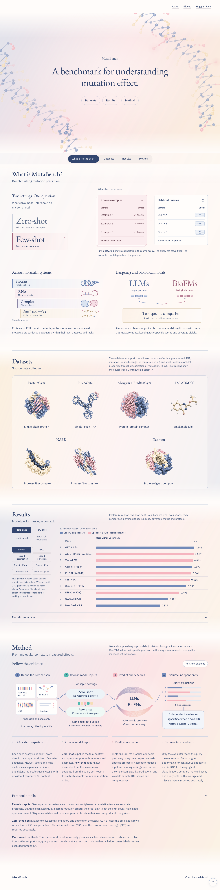

# MutaBench website

Explore datasets, model comparisons and evaluation methods for molecular prediction.

[GitHub benchmark repository](https://github.com/kevinhyj/MutaBench) · [Website & leaderboard](https://kevinhyj.github.io/MutaBench-web/) · [Dataset on Hugging Face](https://huggingface.co/datasets/yanjiehuang/MutaBench) · [Contribute a dataset](https://github.com/kevinhyj/MutaBench-web/blob/main/CONTRIBUTING.md)
<!-- Add the paper link here when published. -->

The benchmark repository currently requires collaborator access.

[](assets/web/homepage.png)

## Interactive preview

Run this command from the repository root and open [the local website](http://127.0.0.1:8000/).

```sh
python3 -m http.server 8000 --bind 127.0.0.1
```

In Results, choose an evaluation setting, task and condition to see the matching chart and score table.
